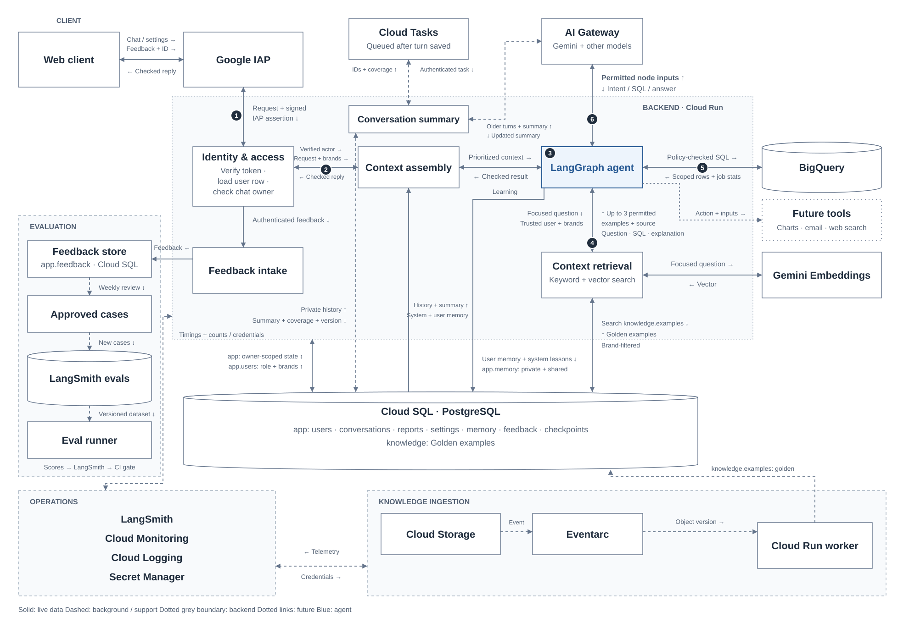
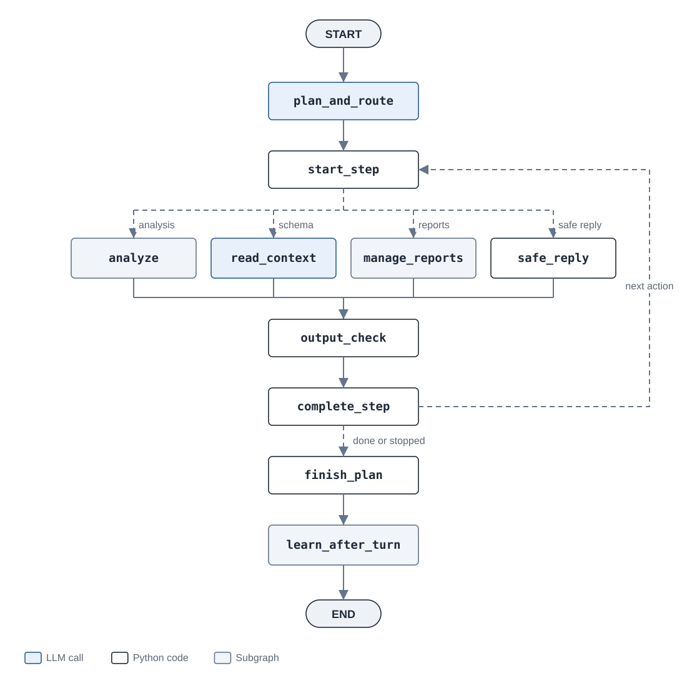
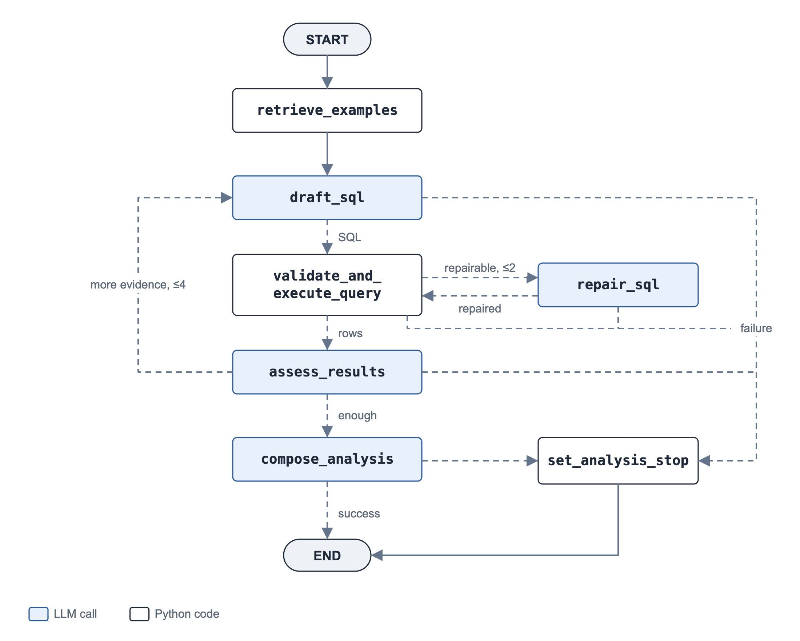
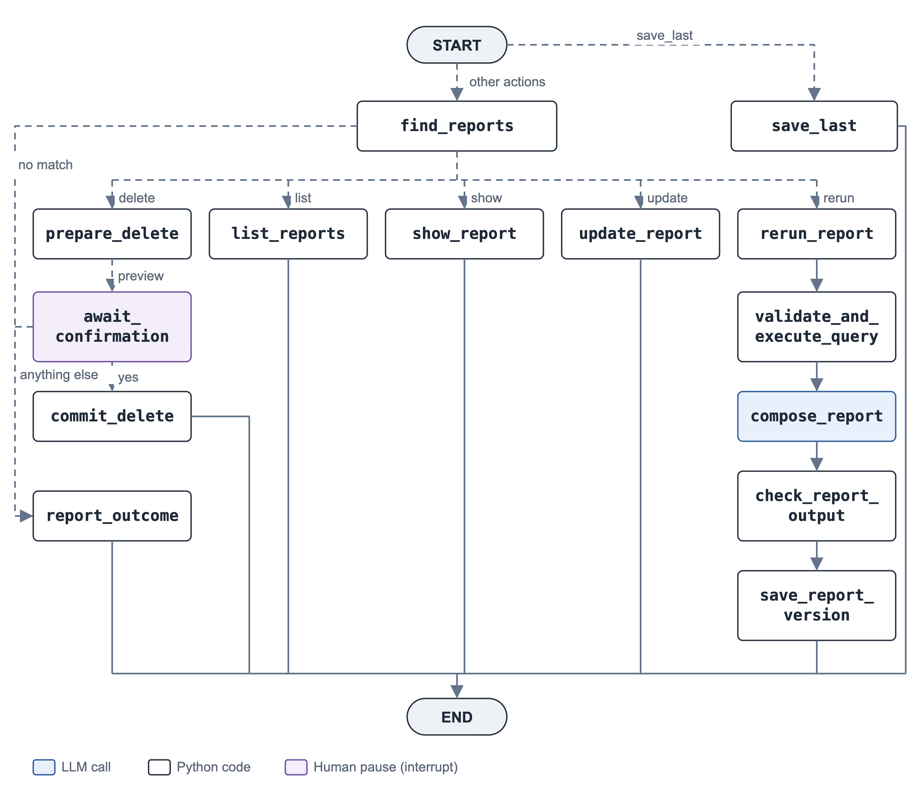
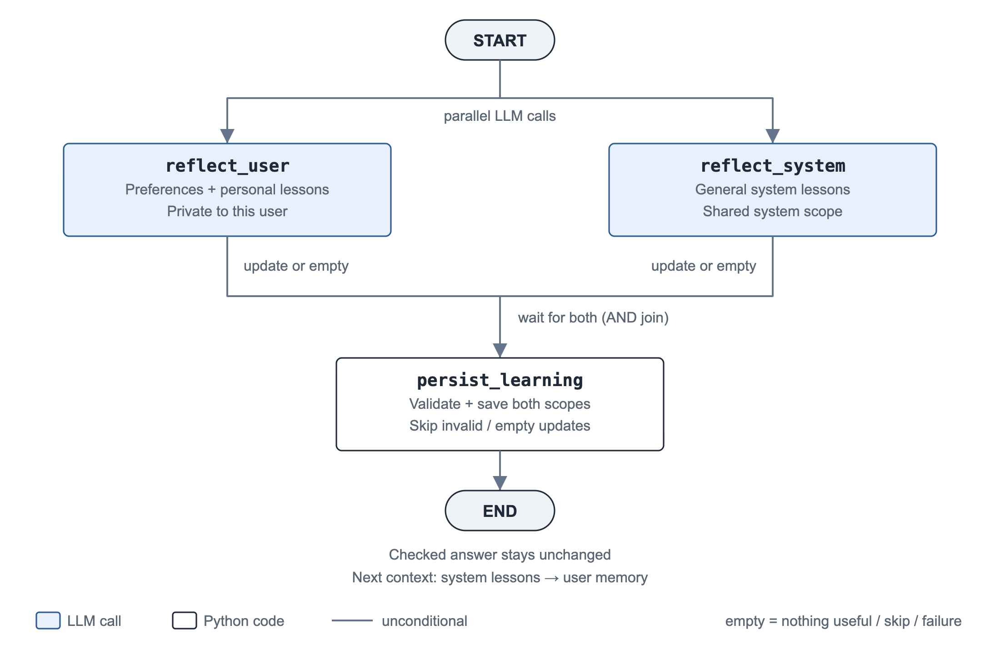
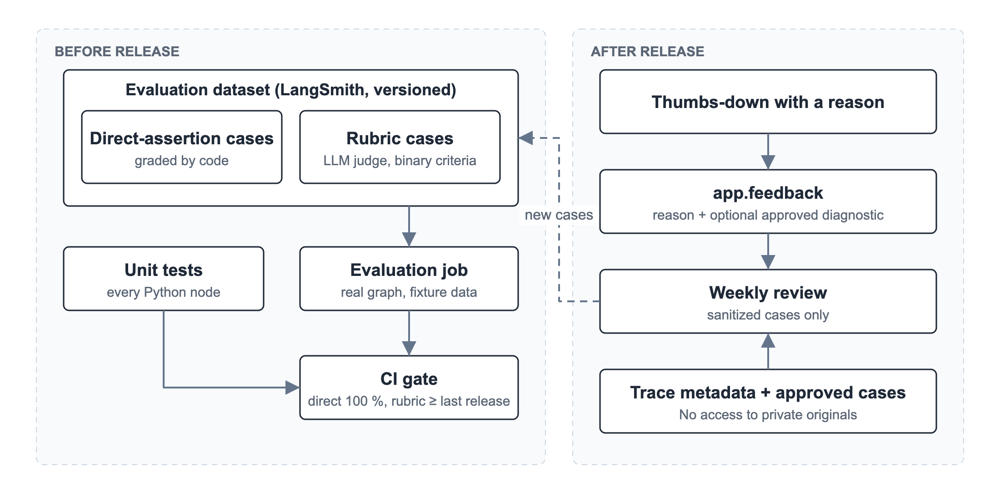

# Retail Analysis Assistant

Production design for the OpsFleet retail assignment.

## Summary

Users chat through a web client authenticated by Google IAP. A Cloud Run backend checks access, loads context and runs the LangGraph agent. Gemini, through AI Gateway, plans the work, drafts SQL and writes answers. Privacy and access enforcement are never delegated to the agent. Trusted backend code and database controls enforce brand permissions and exclude personal fields. Python requires confirmation before deleting reports.

BigQuery provides retail data, and Golden Knowledge examples guide analysis. Cloud SQL (PostgreSQL) stores conversations, private reports, settings, learned lessons and the knowledge index. Background jobs update knowledge and summarize older chats. LangSmith provides tracing and evaluations, while Cloud Monitoring tracks service health.

As confirmed by the client, managers can analyze their assigned brands and the CEO can analyze all brands. Saved reports are private to their author. Each deployment serves one company.

1. [Production architecture](#1-production-architecture)
2. [Agent workflow](#2-agent-workflow)
3. [Message flow](#3-message-flow)
4. [Data model](#4-data-model)
5. [Requirements](#5-requirements): [5.1 Hybrid intelligence](#51-hybrid-intelligence) · [5.2 Safety, PII and per-user access](#52-safety-pii-and-per-user-access) · [5.3 High-stakes oversight](#53-high-stakes-oversight) · [5.4 Continuous improvement](#54-continuous-improvement) · [5.5 Resilience and error handling](#55-resilience-and-error-handling) · [5.6 Quality assurance](#56-quality-assurance) · [5.7 Observability](#57-observability) · [5.8 Agility](#58-agility)
6. [Production operations](#6-production-operations)

## 1. Production architecture HDL

| Diagram element | Purpose |
| --- | --- |
| Web client | The interface where users chat with the assistant, manage reports, change settings and give feedback. |
| Google IAP | Signs users in and attaches a signed identity assertion. |
| Identity & access | Verifies identity, loads brands and checks conversation ownership. |
| Context assembly | Loads shared system lessons, private user memory, permitted history, settings and schema. |
| LangGraph agent | Plans and runs analysis or report actions with access checks and deletion confirmation. |
| AI Gateway | Routes generation through Vercel to Gemini and the configured fallback. |
| BigQuery | Runs SQL checked against policy and returns permitted retail data. |
| Context retrieval | Finds permitted Golden Knowledge examples. |
| Gemini Embeddings | Calls Gemini directly to turn text into vectors for searching by meaning. |
| Cloud SQL · PostgreSQL | One managed PostgreSQL database stores application records, private and shared memory, and Golden examples. |
| Future tools | Extension points for charts, email and web search, with permission checks and confirmation where needed. |
| Cloud Tasks | Queues summaries after turns are saved and retries failed deliveries. |
| Conversation summary | Summarizes older permitted messages outside LangGraph and saves checked summaries. |
| Cloud Storage | Keeps approved Golden Knowledge files and their versions. |
| Eventarc | Sends file changes to the ingestion worker. |
| Cloud Run worker | A separate service validates and indexes approved Golden Knowledge files. |
| Feedback intake | Checks ownership, screens personal information with Jev and requests storage approval. |
| Feedback store | Keeps feedback and approved diagnostic copies in Cloud SQL's `app.feedback`. |
| Approved cases | Screened feedback approved by its owner and selected for sanitized evaluation cases. |
| LangSmith evals | Stores versioned evaluation datasets and experiment results. |
| Eval runner | Runs cases in an isolated Cloud Run Job and sends scores to the release gate. |
| LangSmith | Records agent steps, timings and failures without private content. |
| Cloud Logging | Collects operational events without private content. |
| Cloud Monitoring | Measures latency, throughput and errors and raises alerts. |
| Secret Manager | Stores credentials accessed through IAM permissions. |

### Technology choices

| Choice | Reason |
| --- | --- |
| Google Cloud and Cloud Run | BigQuery is supplied and Gemini preferred. Cloud Run hosts HTTP services and evaluation jobs without server management. |
| Google IAP | Provides the sign-in boundary with a verified identity for each request. |
| LangGraph | Fits predictable analysis and report workflows while letting the model plan, draft SQL and request evidence. Explicit routing and checkpoints reduce custom orchestration. |
| Gemini | Flash Lite prioritizes latency and cost across multiple calls. SQL, intent and report-quality evaluations must pass before release. |
| Vercel AI Gateway | Unifies routing, fallback visibility and cost tracking, at the cost of a network hop and shared dependency. |
| Cloud SQL with pgvector | Keeps records, full text search and vectors in one transactional store. This suits the initial corpus without synchronizing another store. |
| Cloud Storage and Eventarc | Versioned files let the index be rebuilt. Events avoid polling, but ingestion must tolerate duplicates. |
| TypeSafe. AI - Jev | Screens feedback for PII through AI Gateway. Its probabilistic decisions mean uncertain or failed checks stop submission. |
| Cloud Tasks | Provides authenticated summary delivery with bounded retries. Writes must tolerate repeats. |
| LangSmith and Cloud Monitoring | Cover agent traces, evaluations and service metrics. Exported traces omit private content. |
| Pulumi | Defines infrastructure in Python through the deployment pipeline. |

**Framework behavior.** LangGraph provides interrupts for confirmation, conditional routing and PostgreSQL checkpoints for recovery. Model and BigQuery wrappers handle retries. Python policy and database permissions enforce authorization.

**Models.** Defaults are `gemini-3.5-flash-lite` and fallback `gemini-3.1-flash-lite`, set through `GEMINI_MODEL` and `GEMINI_FALLBACK_MODEL`. Requests start with the primary and may try the fallback once after a transient failure or empty response. Both share schemas and policies. Staging evaluates quality, latency and cost.

Generation uses the gateway's OpenAI compatible API, with attempts and costs recorded (section 5.7). Embeddings call Gemini directly: `gemini-embedding-001`, document/query task types, 768 dimensions. `gemini-embedding-2` remains a later option.

**Experience.** I have used LangChain and Claude Agent SDK. LangGraph was mostly new to me, so I checked subgraph interrupts, checkpointing and structured output through `langchain-google-genai` before choosing it.

## 2. Agent workflow

### 2.1 Conventions

One compiled graph serves all users, with a thread per conversation. Solid edges always run, while dashed edges select one target. Subgraphs return state to their parent. Expected failures return a status. Unhandled exceptions abort the invocation (section 5.5 covers recovery).

### 2.2 Main graph

The planner orders actions within a configurable output token limit, without a fixed action count. Python validates the whole plan before execution. Invalid or truncated plans, clarification, refusal, or an analysis request from a manager with no brands stop it before any action runs.

Actions cover analysis (A), schema questions (`read_context`), report management (B) and safe replies. The safe-reply route also acknowledges presentation preferences such as “Use bullet points from now on.” Every action passes `output_check`, which replaces invalid answers with fixed safe text. Success advances the plan. Failure, denial, clarification or cancellation stops the rest. Replies combine newly completed answers and count skipped actions. Completed writes remain. Confirmation replies omit previously displayed answers.

Report formatting changes style. Saving requires a separate action. A reference to the preceding action uses its exact report IDs. Missing references prompt clarification without widening the search. Deletion pauses on an exact preview. Confirmation resumes at the saved current step without replanning or repeating work. It renews the deadline but keeps shared counters (section 5.5). Learning follows section 5.4.

**Future tools.** Developers add approved actions with defined inputs, results and a Python handler or graph node. Python validates inputs and rechecks permissions. Charts use permitted results or fresh queries checked against policy. Email checks recipients and content and requires confirmation. Web results remain untrusted. All tools share output checks, tracing and execution limits and return their outcome to the plan.

### 2.3 Analysis subgraph (A)

Analysis retrieves examples, drafts and executes checked SQL, assesses evidence, then writes the answer. Drafting uses the original request, focused action, schema, examples and earlier results. It returns SQL, assumptions and any requested cutoff. Python fixes one cutoff per analysis and retains it through repairs and follow-up queries. The query node returns rows and job metadata, a repairable error, or a stop (section 5.2).

Two bounded loops handle gaps:

- **Repair:** parse failures, unknown columns and BigQuery `BadRequest` errors allow at most two repairs using the previous SQL and sanitized error. Repaired SQL passes the policy again. Denials cannot be repaired.
- **More evidence:** assessment can request queries within the shared limit of four queries. An ordinary empty result allows one filter recheck per action, then reports no matching rows. Empty demographic results never trigger that recheck. With executed results, a limit or assessment model failure leads to composition. Without them, assessment stops. A new analysis also stops if the query budget is spent.

Composition uses evidence, assumptions and presentation settings. Other model failures, timeouts, policy denials and BigQuery outages clear results and return safe text. The subgraph returns success, failure or denial with a stop reason, then passes the main output check.

### 2.4 Report management subgraph (B)

**Save and update.** Save a successful analysis's question, SQL and answer after brand, safety and deadline checks. Repeated saves return the existing report. Title or note updates increment its version.

**Find and view.** Ownership and current brand access filter searches before matching titles, questions and answers. SQL and rows are excluded. PostgreSQL combines keyword and semantic rankings through reciprocal rank fusion, favoring keyword hits and rejecting weak semantic matches. All, conversation and text searches return every eligible match. Latest and ID select specific reports. Ambiguous requests to view one report require clarification.

**Delete.** Search finds candidates, but only the confirmed preview authorizes deletion (section 5.3). “Delete all” previews every eligible match. Unfiltered lists and previews show these with neutral labels, IDs and dates. Their content cannot be searched or displayed. No matches or cancellation deletes nothing.

**Rerun.** Saved SQL passes the current policy. The checked answer becomes a new report version.

Reports and their search vectors stay in `app.reports`, separate from analysis examples in `knowledge.examples`. Completed actions pass the output check.

## 3. Message flow

The seven steps expand the architecture figure’s six connections. Schema and report branches are in section 2.

1. **Verify access.** Check IAP's assertion, match its email in `app.users` and verify conversation ownership. Unknown users receive 401. Another user's conversation returns 404.
2. **Assemble context.** Load shared system lessons, private user memory, permitted history, schema and resolved settings. Fixed access, safety, schema and metric rules come first. Shared system lessons follow as high-priority guidance, ahead of personal preferences and conversation history. Presentation settings follow section 5.8.
3. **Plan.** Validate actions before dispatch. Invalid plans, clarifications and refusals yield one safe reply.
4. **Retrieve.** Find up to three permitted examples for the focused question and trusted user/brand scope (section 5.1).
5. **Query.** Draft SQL and assumptions, then apply the query policy (section 5.2).
6. **Answer.** Assess evidence, compose and check the answer, then advance on success.
7. **Persist.** Combine outcomes without a model call. Extract and save private user memory and shared system lessons (section 5.4), store the turn, executed SQL and BigQuery job IDs in `conversations.content_json`, and schedule any summary update without awaiting it. Job IDs support authorized result access (section 5.5).

Generation in steps 3, 5, 6 and 7 uses AI Gateway. Retrieval embeds directly through Gemini. Feedback bypasses the agent: after identity verification, it writes to `app.feedback` with the turn's trace ID.

### Runtime context and graph state

**Runtime context** comes from the backend: verified user, role and brands, conversation/turn IDs, limits, deadline, clients, schema and settings. The backend reloads `app.users`. Context and credentials are never checkpointed. Prompts receive relevant copies, but Python enforces permissions from the trusted user.

**Checkpointed state** preserves the plan, action, outcomes, question, history, settings, report references, evidence and shared query/repair counters, plus deletion candidates, proposal ID, previewed IDs/versions, final answer and status. The plan ID preserves the original turn ID across confirmation. New messages reset turn state. Dispatch resets action fields while keeping completed work and counters. History retains the original message, and reports retain their source analysis question.

### Conversation window

Context contains the latest 10 turns, plus a checked summary when available and intervening unsummarized turns. After 40 turns or the token limit, Cloud Tasks and Gemini summarize older permitted messages, leaving the latest 10 intact. Full history and report IDs remain stored.

Summaries are versioned and invalidated when access changes. Oversized context requires a summary refresh before continuing, or a retry message. Background failures retry within limits, then raise an alert.

## 4. Data model

BigQuery's authorized views exclude personal columns. Cloud SQL separates application data and LangGraph checkpoints (`app`) from Golden examples (`knowledge`).

| Table | Columns | Writer |
| --- | --- | --- |
| `app.users` | `id, email, role (manager \| ceo), brands text[]` | Administrator |
| `app.conversations` | `id, owner_id, title, content_json, updated_at` | Backend turn and summary handlers |
| `app.reports` | `id, owner_id, conversation_id, title, content_json, embedding, created_at` | Agent on save, backend on delete |
| `app.settings` | `id, owner_id (null = company default), data_json, updated_at` | Settings endpoint |
| `app.memory` | `id, owner_id (null = system lesson), kind (profile \| lesson), content_json, updated_at` | Learning subgraph |
| `app.feedback` | `id, owner_id, conversation_id, turn_id, trace_id, reason, diagnostic_json, review_approved_at, created_at` | Feedback endpoint |
| `knowledge.examples` | `id, content_json, embedding, created_at` | Golden Knowledge ingestion worker |

In the client requested `app.users` table, managers list exact `products.brand` values. The CEO's role grants all brands despite an empty list. Only administrators can write to it. The assistant can only read it.

| JSON field | Contents |
| --- | --- |
| `conversations.content_json` | Messages, summary and its coverage, source brands, action outcomes, request IDs, report and trace references. |
| `reports.content_json` | Question, SQL, answer, brands, cutoff timestamp, assumptions, notes and version. |
| `settings.data_json` | Format, detail, language, tone and custom instructions. Each change creates a version. |
| `memory.content_json` | Private preferences and personal lessons, or shared system lessons. Source references stay internal. |
| `examples.content_json` | Reusable questions, SQL, explanations, brands and source. |

Source IDs, query references and versions support access checks, retries and tracing. Settings fields are validated, and custom instructions have a length limit.

Report uniqueness on `(conversation_id, content_json.turn_id, content_json.step_index)` prevents duplicate saves while separating analyses. Memory updates are keyed by conversation, turn and learning scope (user or system) to avoid duplicates on retries. Earlier copies in checkpoints and history remain owner-restricted under a separate retention policy.

## 5. Requirements

### 5.1 Hybrid intelligence

**Requirement.** Use approved analyst trios (question, SQL, report) to guide new answers.

**Ingestion.** Analysts publish evaluated, approved trios as versioned Cloud Storage objects. Eventarc sends the object version to the worker, which validates it and embeds its question and interpretation. It writes to `knowledge.examples`, keyed by object name and generation. A transaction activates each complete generation and retires its predecessor. Duplicate or older events are ignored. The index can be rebuilt from the bucket. Ingestion runs outside chat and alerts on persistent failures.

**Retrieval.** Once per analysis, `retrieve_examples` embeds the focused question. Reciprocal rank fusion merges keyword and vector rankings, combining exact wording with matches based on meaning. Brand filters apply before ranking. Up to three permitted Golden examples enter the prompt. If nothing matches or retrieval is unavailable, analysis continues without examples. Drafted queries still pass policy. The small initial corpus does not need a reranker.

### 5.2 Safety, PII and per-user access

**Requirement.** Restrict the assistant to analysis, resist malicious requests, exclude personal data and enforce each user's product access.

Python enforces brands, columns and query limits, excluding personal fields before results reach the model. Output checks catch recognizable personal data. Prompts cannot grant permissions.

#### Identity and scope of use

For each request, the backend verifies Google IAP's assertion and looks up the verified email in `app.users`. Unknown users are rejected. Trusted runtime context supplies current role and brands. Messages, retrieved text and model output cannot alter them.

The router accepts analysis, schema, report and presentation preference requests, clarifies ambiguity and refuses unrelated work, personal data requests, transaction writes and permission changes. Only `validate_and_execute_query` reaches BigQuery.

Query policy

`validate_and_execute_query` applies these checks in order:

| Step            | Rule                                                                                                                                                                                                                                                                                                                                                     | On violation                                   |
| --------------- | -------------------------------------------------------------------------------------------------------------------------------------------------------------------------------------------------------------------------------------------------------------------------------------------------------------------------------------------------------- | ---------------------------------------------- |
| 1 Parse         | Parse with SQLGlot using the BigQuery dialect. Require exactly one statement.                                                                                                                                                                                                                                                                            | Repair parse errors. Deny multiple statements. |
| 2 Shape         | Require a top level `SELECT`. Allow nested queries in `FROM`, `WHERE` and `IN`. No `WITH`, set operations, DDL, DML or scripts.                                                                                                                                                                                                                          | Denial                                         |
| 3 Tables        | Only `orders`, `order_items`, `products`, `users`, bare or qualified with the allowed dataset.                                                                                                                                                                                                                                                           | Denial                                         |
| 4 Columns       | Block shopper names, email, street addresses, postal codes, coordinates and location geometry, including in subqueries. Block `SELECT *` and `alias.*`, but allow `COUNT(*)`. No raw age, city or gender in production. Apply demographic rules below.                                                                                                   | Denial. Unknown columns are repairable.        |
| 5 Functions     | Reject function names that start with [blocked prefixes](../assistant/sqlpolicy.py) for external data, session identity, machine learning, AI, URL and IP utilities, encryption and key handling. Also reject dotted function calls. Dotted column references remain allowed. Model SQL cannot use `UNNEST` or parameters other than `@analysis_cutoff`. | Denial                                         |
| 6 Scope rewrite | Expose only approved view columns and apply the demographic privacy rules below. For managers, restrict products to trusted brands, items to those products, orders to those items, and users to their buyers. Preserve aliases. The CEO sees the same approved columns across all brands.                                                               | n/a                                            |
| 7 Execute       | Attach job labels and enforce the turn deadline. Fetch and parse pages of up to 200 rows, following every page token with no total row cap. Check the deadline for each page. Sanitize syntax and semantic errors for repair.                                                                                                                            | Repairable error. Stop on BigQuery outage.     |

Python applies verified brand permissions and a fixed analysis cutoff through SQL parameters. Sales periods use order dates, while delivery and return dates enforce the cutoff. The cutoff does not guarantee fresh data. The model receives the executed SQL. Denied queries stop, while syntax and column errors allow limited repair.

Production also uses restricted service accounts and database views to enforce brand and column access independently.

**Demographic privacy.** Customer rankings show IDs and business metrics only. Demographic analysis uses approved groups, such as age bands and state, without individual IDs. Groups below a configured minimum are hidden before results reach the model, reports or downloads. Queries stop if these protections cannot be verified. Grouping rules and minimum sizes require privacy review before deployment.

#### Output checks

`output_check` checks every action. Saving rechecks the source answer. Deletion checks its preview before pausing. User learning uses checked answers. System learning can also use sanitized tool failures and repair outcomes.

- **Empty or personal data:** replace empty answers or those containing detected emails, phone numbers, street addresses or coordinate pairs with fixed text. Do not save or learn from them.

Brand permissions apply to queries, reports and conversation history. Answers explain what the results cover, include counts alongside percentages, and distinguish measured facts from possible explanations.

#### Report and conversation privacy

PostgreSQL row level security enforces ownership for conversations, reports and private memory. Each transaction uses a verified identity. Checkpoint access is tied to the conversation owner. Everyone can read company defaults. Only the CEO can edit them. Golden examples require brand access. User memory remains private to its owner. System lessons have no owner and are readable by all users, but only the backend system-learning path can write them. Ownerless memory rows must have `kind = lesson`. The CEO cannot read others' private records. The assistant reads `app.users`. Only administrators change access. Operational review exposes only approved diagnostic copies and metadata, without owner impersonation.

### 5.3 High-stakes oversight

**Requirement.** Delete owned reports by text match or conversation only after chat confirmation.

After candidate selection (section 2.4):

1. `prepare_delete` checks the complete preview for personal data, records a proposal ID and exact report IDs with versions, and shows titles or neutral labels with match reasons. A failed check denies deletion without pausing.
2. `await_confirmation` uses `interrupt()` to wait for the next message. An affirmative answer proceeds. Anything else cancels. A substantive new request starts a new turn.
3. `commit_delete` locks the owned target reports and rechecks their versions. If any changed, nothing is deleted. The user receives an updated preview of those IDs and must confirm again. Otherwise, one transaction deletes only previewed, still-owned reports. Missing IDs are skipped. The reply gives the deletion count. Traces record the count and outcome without report content.

Nothing is deleted until confirmation. Only previewed reports that the user still owns can be deleted, including reports they can no longer read. New reports are never added to the list. Cancellation or an empty list deletes nothing.

If permissions change, refresh the preview labels and cancel if earlier analysis is no longer authorized. Multi step requests show completed answers alongside the preview, then resume from the paused step after confirmation.

### 5.4 Continuous improvement

**Requirement.** Remember presentation preferences and learn from past interactions.

After `finish_plan`, two independent LLM calls run in parallel within the learning allowance (section 5.5).

**User-level learning.** `reflect_user` reads the exchange and the user's existing memory. It extracts useful preferences, such as tables or brief answers, and short personal lessons. A preference only message can be learned immediately. Refused requests and rejected output are skipped. This memory stays private to the user, who can view, reset or disable it.

**System-level learning.** `reflect_system` reads existing shared lessons and sanitized summaries of tool errors, repairs and execution outcomes. It extracts general lessons that can improve future requests for every user. The input excludes private messages, reports, SQL literals, brand specific identifiers and transaction values. Shared lessons are saved automatically, without an analyst approval step, and context assembly loads them on the next request in a high priority `system_lessons` block (section 3).

`persist_learning` validates both updates and assigns their scope in Python: the verified user's ID for private memory, or `owner_id = null` for system lessons in `app.memory`. It skips invalid, empty or failed updates without changing the answer. Learned memory cannot change fixed instructions, permissions, schema or metric definitions.

### 5.5 Resilience and error handling

**Requirement.** Recover from SQL errors, empty results and service failures within execution and retry limits.

Limits apply to the whole plan. Human confirmation starts a new 120-second deadline but does not reset query or repair counts.

| Limit | Initial setting | Purpose |
| --- | --- | --- |
| SQL repairs | 2 per plan | Allow corrections without an endless repair loop. |
| Query executions | 4 per plan | Leave room for follow-up evidence while controlling cost. |
| Rows in model prompts | 12 for drafting/repair, 15 for assessment, 60 for composition | Control tokens and latency. |
| Conversation context | Summary and all permitted unsummarized turns, including the latest 10 | Preserve continuity within the input budget (section 3). |
| Historical text | 1,200 characters per question, answer or action label, without result rows | Keep earlier turns compact while preserving exact report IDs. |
| Download size | At most 1 GB | Bound file size, without a row-count cap. |
| Model attempts | 1 primary + 1 fallback | Recover without long retry chains. |
| Learning time | Up to 5 seconds within the remaining deadline | Limit delay before reply delivery. |
| Planner output | Configured token cap | Reject incomplete plans without limiting the number of actions. |
| Active execution time | 120 seconds per invocation or confirmation resume | Stop work that runs too long. |

These are starting values to tune with representative staging requests, including multi step tasks. Load tests establish baselines before service targets are set. Production measurements guide later adjustments.

**Failure handling**

| Failure | Response |
| --- | --- |
| Policy denial | Stop with a clear reason. Never repair a denied query. |
| Malformed SQL, unknown column or BigQuery `BadRequest` | Give `repair_sql` a sanitized error, up to the repair limit. |
| Empty result | Allow one filter recheck for ordinary queries. Demographic queries report no shareable groups without widening filters. |
| Primary model timeout, 429, transient 500/503 or empty reply | Try the fallback once if time remains. |
| Fallback fails | Stop. During assessment, continue to composition using existing evidence. |
| Invalid structured output, authentication, permission or request error | No fallback. Planning asks for clarification, assessment uses existing evidence, and other analysis steps stop. |
| Provider outage | The gateway can try another provider for the same model, then the application applies model fallback. |
| Gateway connection failure or 5xx | Try the fallback once. A full gateway outage stops work until an operator switches to the direct Google API. |
| BigQuery 5xx or timeout | Retry twice at most, after 2 and 5 seconds, checking the existing job ID to avoid duplicate submissions. |
| Deadline or application database failure | Stop remaining or dependent work and report what completed. Never assume a write succeeded. |
| Restart or unhandled exception | Recheck access, resume the checkpoint and reconcile unfinished operations. |
| Retrieval, learning or telemetry failure | Continue without examples, skip learning, or keep the answer despite missing telemetry. |
| Summary failure | Keep the last valid summary and retry the background task. If context cannot fit, ask the user to retry before starting the agent. |
| Feedback write failure | Offer a submission retry. Analysis is unaffected. |

The application controls model fallback, while the gateway controls provider failover. Disable the gateway's separate model-fallback list to avoid multiplying attempts. An empty `GEMINI_FALLBACK_MODEL` disables fallback. Later failures do not undo completed actions.

**Large results and downloads.** Queries have no automatic SQL row limit. Explicit limits, such as a requested top five, are preserved. The query node fetches and parses up to 200 rows per page, then follows the next page token in a loop until every row is collected. The page size is not a total row cap. Python handles pagination without an LLM call per page. Each fetch shares the turn deadline. A failed or timed-out fetch stops the action instead of presenting incomplete results as complete. Prompts use the smaller samples above, shorten text cells beyond 500 characters and disclose omissions. A small aggregate can still summarize a complete population. A result row count is not necessarily a transaction count.

Owners can download the query results by job ID after a fresh ownership and brand check, subject to the file-size limit above. BigQuery results last up to 24 hours and can expire sooner, after which the query must run again. CSV downloads use a private user prefix in Cloud Storage, a one-hour signed link and seven-day file expiry. See [BigQuery result storage](https://docs.cloud.google.com/bigquery/docs/writing-results) and [cache lifetime](https://docs.cloud.google.com/bigquery/docs/cached-results).

### 5.6 Quality assurance

**Requirement.** Test correctness before release and use production feedback to improve the system.

**Before release.** A versioned LangSmith dataset runs through the real graph against fixtures and a scratch database. It checks two things:

- **Correctness and safety:** expected figures, metrics and dates, bound brand filters, blocked personal fields, demographic suppression without individual IDs, refusals and exact deletion outcomes.
- **Answer quality:** correct scope, supported claims, clear assumptions, useful recommendations and the requested format. A stronger model grades each criterion as pass/fail using `openevals.create_llm_as_judge` and explains its decision. Every criterion must pass for that answer. Calibrate the judge against about fifty human labelled answers, use corrections as examples, and recalibrate when criteria change.

Unit tests cover Python policy, routing, ownership, confirmation, settings and failure handling with stub clients. Every release runs both suites. Direct assertions must all pass, the rubric pass rate must not fall below the previous release, and each case records latency and cost.

**After release.** Users can mark an answer or report as unhelpful and explain why. They may attach a diagnostic copy with synthetic values. Weekly reviews grade approved copies against the same rubric without opening private originals. Traces track time per task, clarification, cancellation and negative feedback rates.

**Turning feedback into tests.** The feedback endpoint verifies the owner, conversation, turn and trace from stored records, bypassing the agent:

1. Jev (`typesafe-ai/jev` through AI Gateway) screens the reason and optional diagnostic copy for personal information.
2. The fallback model redacts flagged content, then Jev and pattern checks inspect it again. Failed, uncertain or still-flagged checks reject submission and ask for edits or a retry.
3. The owner approves the final screened copy for review and sanitized reuse in evaluations and Golden Knowledge. It is stored in `app.feedback`. Edits clear approval.
4. Reviewers turn approved submissions into synthetic test cases. Published cases exclude original chats, transaction rows and identities, and pass the same screening. Fixes must pass the updated evaluation suite before release.

Screening reduces risk but cannot guarantee detection. Review access uses an audited IAM-protected endpoint exposing approved copies and content free trace metadata only. A feedback submission does not grant access to its private source. Submitted feedback does not directly edit memory. This evaluation workflow is separate from the automatic learning calls in section 5.4.

### 5.7 Observability

**Requirement.** Detect failures, measure performance and investigate individual turns.

LangSmith groups each invocation and confirmation resume by conversation. Traces record step timing, models, tokens, query usage, retries, fallbacks, plan progress and outcomes. Failures are marked at the root, while refusals, clarification, cancellation and waiting for confirmation remain distinct. Prompts, answers, SQL, rows, report IDs, previews and raw errors are removed before export. Record every deletion trace, subject to retention rules.

Owners inspect their saved turns using the trace reference. Reviewers see only approved diagnostic copies and metadata (section 5.6). A trace ID does not grant access to private records.

Cloud Monitoring tracks response and step latency (p50, p95, p99), unique turns per minute, errors, repairs, stop reasons, ingestion lag and cost per turn. Gateway metadata breaks costs down by model, provider, user and tag, with budget alerts at 50%, 75% and 100% per environment key. Alerts also cover ingestion failures, exhausted summary retries and sustained latency or error increases against the staging baseline. Summary traces contain timing, outcome and coverage, without message text. Each store has a retention policy.

### 5.8 Agility

**Requirement.** Let the CEO change report tone without developer help or redeployment.

The settings page in the web client stores versioned format, depth, language and tone preferences in `app.settings`. The CEO edits company defaults and users edit their own preferences. Changes apply to the next answer and can be rolled back.

Style follows the current request, then user settings, learned preferences and company defaults. The CEO’s tone applies unless the user explicitly chooses another. “Use company tone” removes that override and follows future company updates.

Shared lessons guide how tasks run. Preferences cannot override fixed instructions, access permissions, allowed columns, SQL rules or deletion confirmation.

## 6. Production operations

Each service has limited permissions, and the database uses private access and backups. Development, staging and production are separate. Changes are tested in staging, released gradually and rolled back if errors increase. Logs exclude private data and credentials.
